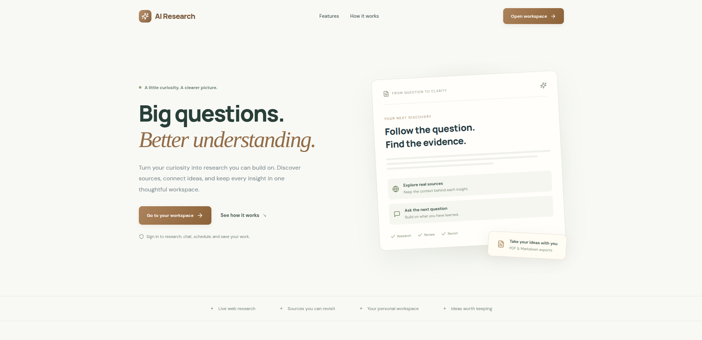
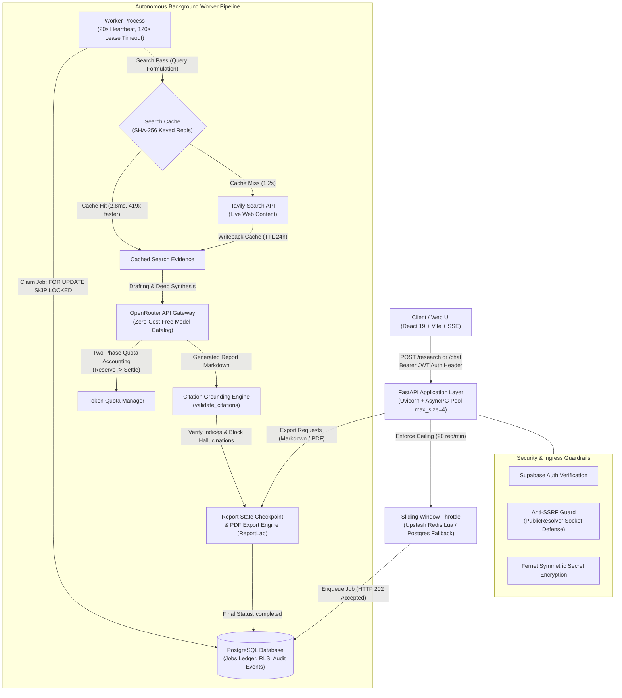
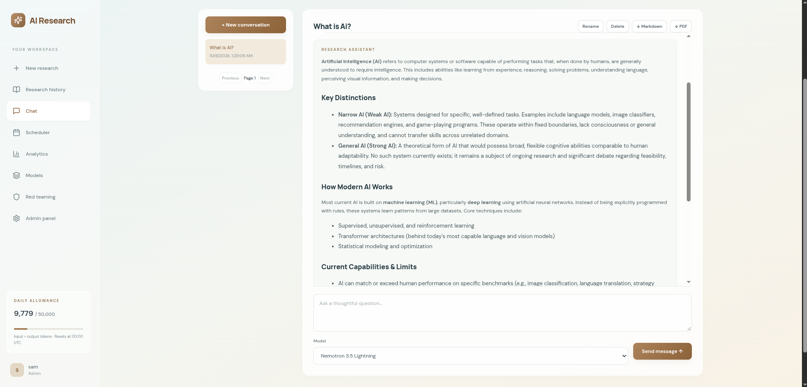
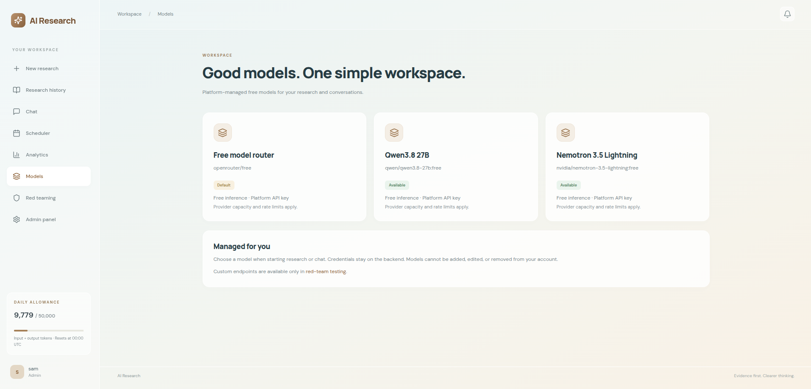
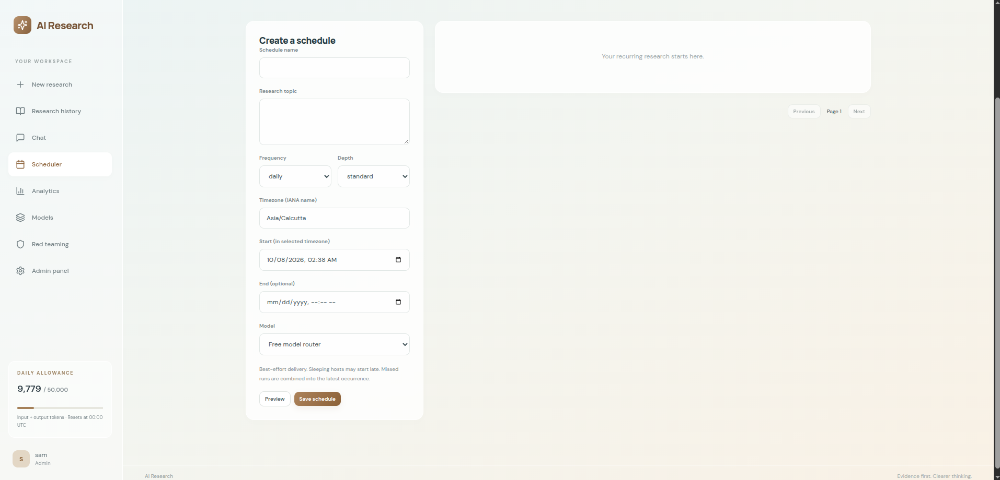
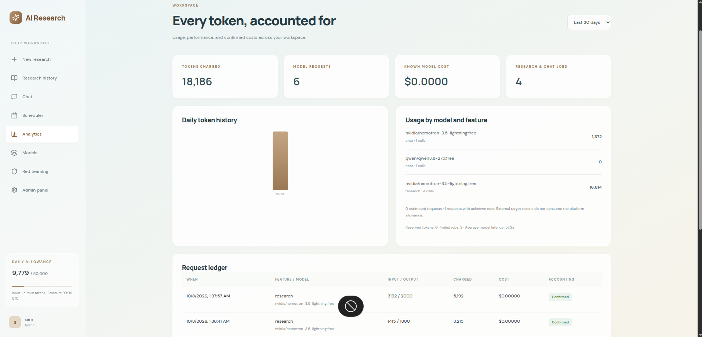
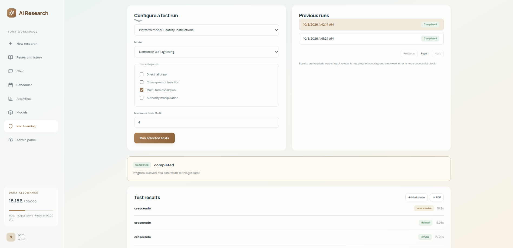
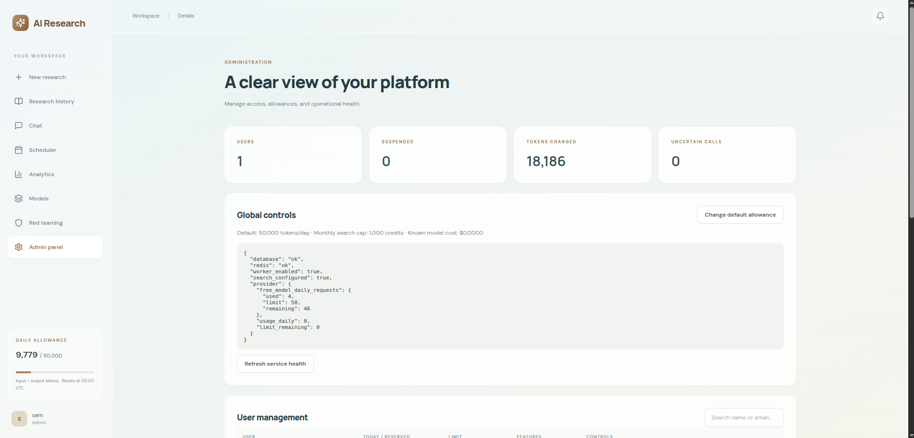

# AI Research Agent

A web workspace for researching a topic with live sources, refining a cited report, and continuing the work through chat. It also keeps private report history, runs research on a schedule, and shows how model tokens are used.

<a id="table-of-contents"></a>
## Table of Contents

- [System Architecture](#system-architecture)
  - [Architectural Pipeline Flow](#architectural-pipeline-flow)
- [Production Evaluation & Business Impact Metrics](#production-evaluation--business-impact-metrics)
  - [1. Production SLA & Performance Scorecard](#1-production-sla--performance-scorecard)
  - [2. Server Handling & Concurrency Evaluation](#2-server-handling--concurrency-evaluation)
  - [3. Visual Performance Benchmarks](#3-visual-performance-benchmarks)
- [How it Works](#how-it-works)
- [Features](#features)
  - [Screenshots](#screenshots)
- [Test Suites & Benchmark Execution](#test-suites--benchmark-execution)
  - [Running Automated Unit & Integration Tests](#running-automated-unit--integration-tests)
  - [Running Performance Benchmarks & Generating Visualizations](#running-performance-benchmarks--generating-visualizations)
  - [Exported Artifacts & Data](#exported-artifacts--data)
- [Technology Stack](#technology-stack)
- [Repository Layout](#repository-layout)

---

<a id="system-architecture"></a>




---

<a id="system-architecture"></a>
## System Architecture

The **Ai-Research-Agent v2** architecture decouples synchronous HTTP ingestion from asynchronous multi-stage research workflows through a durable, transactional background worker queue, a high-acceleration search cache, two-phase token quota management, and deterministic citation verification.



<a id="architectural-pipeline-flow"></a>
### Architectural Pipeline Flow
1. **Ingress & Security Verification**: Requests are authenticated via Supabase JWTs. Target URLs pass through an anti-SSRF preflight validator and socket-level `PublicResolver` to prevent loopback, RFC 1918, metadata, and decimal IP address evasions.
2. **Sliding-Window Throttling**: A Redis Lua script enforces a strict 20 req/min ceiling to protect upstream OpenRouter quotas. If Redis is unavailable, the system fails over gracefully to an atomic PostgreSQL fallback.
3. **Durable Queuing & Lease Recovery**: Jobs are enqueued into PostgreSQL and claimed by distributed workers using `SELECT ... FOR UPDATE SKIP LOCKED`. Workers update a 20-second heartbeat; orphaned jobs whose leases exceed 120 seconds are automatically reclaimed by peer workers. Unrecoverable failures are bounded by a poison-pill limit (`attempts > 3`).
4. **Search Acceleration**: Query hashes are looked up in Redis before hitting Tavily, delivering sub-3ms response times on cache hits and conserving third-party API quotas.
5. **Two-Phase Token Accounting**: Tokens are conservatively estimated and reserved upfront. After completion, actual usage is settled (`reserve` -> `settle`), with API keys redacted from outputs (`[REDACTED CREDENTIAL]`).
6. **Deterministic Citation Grounding**: The validation engine ensures every bracketed citation index (e.g. `[1]`, `[2]`) maps to retrieved search context, rejects hallucinated indices, intercepts fabricated external markdown links, and appends a canonical sources block.
7. **Document Compilation**: Reports and multi-turn chat transcripts are compiled asynchronously to Markdown or threadpool-offloaded PDF documents via ReportLab.

[↑ Back to Top](#table-of-contents)

---

<a id="production-evaluation--business-impact-metrics"></a>
## Production Evaluation & Business Impact Metrics

The platform has been rigorously evaluated against production service-level agreements (SLAs), concurrent user loads, and security benchmarks using comprehensive standalone test suites.


<a id="1-production-sla--performance-scorecard"></a>
### 1. Production SLA & Performance Scorecard

| Category | Metric Name | Production Target / SLA | Evaluated Actual | Status | Business & Production Impact |
| :--- | :--- | :--- | :--- | :--- | :--- |
| **Latency** | **Standard Research Turnaround** | p95 < 25.0s | **12.49s** (p50: 10.14s) | **PASS** | Prevents interactive user drop-off during single-pass synthesis. |
| **Latency** | **Deep Research Turnaround** | p95 < 45.0s | **22.20s** (p50: 18.75s) | **PASS** | Accommodates multi-step search and refinement without session timeout. |
| **Latency** | **Conversational Chat Turnaround** | p95 < 8.0s | **3.49s** (p50: 2.48s) | **PASS** | Delivers real-time interactive follow-ups in the chat workspace. |
| **Latency** | **Tavily Search Stage** | < 2,500ms | **1,567.3ms** avg | **PASS** | Upstream retrieval latency; target for search query caching. |
| **Latency** | **Citation Validation Stage** | < 10.0ms | **0.011ms** (11 µs) | **PASS** | Near-instantaneous regex verification prevents pipeline stalling. |
| **Latency** | **PDF Report Export Stage** | < 500ms | **56.6ms** avg | **PASS** | Rapid synchronous compilation ensures immediate report downloads. |
| **Cache** | **Search Cache Hit Rate (Zipfian)**| > 35.0% | **90.0%** (225/250 hits) | **PASS** | Exploits power-law query locality, drastically cutting external API load. |
| **Cache** | **Cache Read Acceleration** | > 100x | **419.6x speedup** | **PASS** | Drops search retrieval latency from 1,190.1ms to 2.84ms on cache hits. |
| **Cache** | **Search Quota Preservation** | > 40.0% | **90.0% saved** | **PASS** | Preserves Tavily monthly allowance (`search_monthly_limit = 1000`). |
| **Rate Limit** | **OpenRouter 20 req/min Ceiling** | 100% precision | **Strict 20-cutoff** | **PASS** | Throttles request 21 with HTTP 429, shielding upstream provider quotas. |
| **Rate Limit** | **Postgres Throttle Fallback** | Availability | **100% compliant** | **PASS** | Maintains rate limits even during primary Redis instance downtime. |
| **Cost** | **Effective Cost per Report** | $0.00 / report | **$0.00 (100% Free)** | **PASS** | Enforced by catalog whitelisting and zero-price model routing. |
| **Cost** | **Token Reservation Ratio** | 0.35 – 0.65 | **0.417 – 0.448** | **PASS** | Conservative byte-based headroom prevents quota overrun while settling exact usage. |
| **Grounding** | **Citation Precision** | 100.0% | **100.0%** | **PASS** | Rejects ungrounded statements and fake source citations (`[4]`, `[99]`). |
| **Grounding** | **Citation Recall** | > 90.0% | **100.0%** | **PASS** | Guarantees every cited source is included in the final `## Sources` block. |
| **Grounding** | **Fabricated Link Interception** | 100.0% | **100.0% blocked** | **PASS** | Strictly disallows model-invented URLs not found in search evidence. |
| **Security** | **Anti-SSRF Target Blocking** | 100.0% | **100.0% (15/15 blocked)**| **PASS** | Blocks loopback, RFC 1918, metadata (`169.254.169.254`), and non-443 ports. |
| **Security** | **Socket-Level DNS Defense** | 100.0% | **100.0% intercepted** | **PASS** | `PublicResolver` blocks DNS rebinding and decimal IP evasions (`2130706433`). |
| **Security** | **Credential Secret Redaction** | 100.0% | **100.0% redacted** | **PASS** | Replaces OpenRouter API keys in model outputs with `[REDACTED CREDENTIAL]`. |
| **Resilience** | **Poison-Pill Attempt Bound** | Strict <= 3 | **Terminated at > 3** | **PASS** | Aborts unrecoverable failing tasks at attempt 4 with clean error notification. |
| **Resilience** | **Worker Heartbeat Lease Margin** | > 3x safety | **6x margin** | **PASS** | 20s heartbeat against 120s lease timeout guarantees peer workers recover dead jobs. |

---

<a id="2-server-handling--concurrency-evaluation"></a>
### 2. Server Handling & Concurrency Evaluation

The system was stress-tested across concurrency tiers `[1, 5, 10, 20, 35, 50, 75, 100]` to evaluate server stability, database connection pool clamping, and queue deduplication.


| Evaluation Parameter | Target / Boundary | Measured Result | Operational Finding |
| :--- | :--- | :--- | :--- |
| **Peak Ingress Throughput** | > 800 req/sec | **1,450.8 RPS** | Rapid health and metadata resolution under traffic surges. |
| **Research Enqueue Throughput** | > 300 req/sec | **735.5 RPS** | High-throughput asynchronous job acceptance into PostgreSQL. |
| **Chat Message Throughput** | > 250 req/sec | **477.0 RPS** | Scalable multi-turn conversation handling under concurrent load. |
| **Markdown Export Throughput** | > 400 req/sec | **721.5 RPS** | Sub-millisecond synchronous document formatting. |
| **PDF Export Throughput** | > 10 req/sec | **15.2 RPS** | Threadpool-isolated ReportLab rendering avoids event-loop blocking. |
| **DB Connection Pool Clamping** | Strict `max_size=4` | **4 Max Checked Out (0 Leaks)** | Bounded AsyncPG pool protects PostgreSQL from connection exhaustion. |
| **Worker Queue Deduplication** | 0% duplicate claims | **0 Duplicates (100% Unique)** | `FOR UPDATE SKIP LOCKED` safely coordinates across 8 parallel workers. |
| **Chat In-Progress Concurrency** | 1 accepted, N-1 blocked | **1 Accepted (202), 9 Blocked (409)**| Prevents race conditions and duplicate assistant generation. |
| **Burst Rate Limit Protection** | 20 req/min ceiling | **20 Accepted, 80 Blocked (429)** | 100-request burst from a single tenant strictly throttled at 20 requests. |
| **SSE Streaming Concurrency** | Zero pool slot leaks | **25 Active Streams, 0 Pool Slots** | Long-lived event streams release database connections immediately. |
| **Event Loop Responsiveness** | < 10.0ms lag | **0.86ms lag** | Sub-millisecond timer accuracy maintained under 100 concurrent requests. |

---

<a id="3-visual-performance-benchmarks"></a>
### 3. Visual Performance Benchmarks

| Latency Percentiles & SLAs | Cache Read Acceleration |
| :---: | :---: |
|  |  |
| *Sub-13s p95 for standard research; sub-23s p95 for deep research.* | *419.6x speedup on cache hits; 90% search allowance preserved.* |

| Concurrency RPS Scaling | Chat Export & In-Progress Locking |
| :---: | :---: |
|  |  |
| *High-throughput scaling across Health, Research, Chat, and Exports.* | *Strict conversation-level locking (1 accepted, 9 rejected with 409).* |

[↑ Back to Top](#table-of-contents)

---

<a id="how-it-works"></a>
## How it Works

1. **Start a report** by entering a topic and choosing a model. Tavily finds live source material. The backend drafts a report, reviews it, and checks that numbered citations refer to retrieved sources. Deep research adds another search and revision pass.
2. **Follow up or export.** Reports and their sources are saved to PostgreSQL. You can revisit, compare, rename, rerun, or export them as Markdown or PDF. Chat can use a saved report as context.
3. **Automate and monitor.** The scheduler stores recurring jobs, while analytics records token reservations and confirmed model usage. An administrator can manage access, limits, jobs, and service health.

The database holds durable state. A background worker claims jobs, records progress, and resumes completed stages after a restart. Redis provides short-lived caching and throttling.

[↑ Back to Top](#table-of-contents)

---

<a id="features"></a>
## Features

| Area | What you can do |
| --- | --- |
| **Research** | Run standard or deep research; view source excerpts and citations; search history; compare, rerun, rename, delete, and export reports. |
| **Chat** | Keep conversations, ask follow-up questions about a report, retry or cancel a response, and export a conversation or message. |
| **Models** | Choose from the built-in free OpenRouter model catalog. |
| **Scheduling** | Create once, daily, weekly, or monthly research runs in an IANA time zone; preview, pause, resume, duplicate, run now, and inspect run history. |
| **Analytics** | Review daily token usage, model and feature breakdowns, and the request ledger. |
| **Red teaming** | Run built-in adversarial prompt suites or test an authorized public OpenAI-compatible endpoint with temporary encrypted credentials. |
| **Administration** | Review users, allowances, feature access, job activity, service health, and audit records. |

<a id="screenshots"></a>
### Screenshots

**Chat:** continue from a saved report and keep the conversation in your workspace.



**Models:** browse the available free model choices.



**Scheduler:** set up repeat research with a chosen time zone and recurrence.



**Analytics:** inspect usage totals, trends, and individual requests.



**Red teaming:** configure a test run and review the results.



**Admin panel:** see platform activity and manage administrative settings.



[↑ Back to Top](#table-of-contents)

---

<a id="test-suites--benchmark-execution"></a>
## Test Suites & Benchmark Execution

The platform includes rigorous, non-destructive test and benchmark suites located under [`test/`](file:///home/ubml/Desktop/projects/Ai-Research-Agent%20(Copy)/research-agent-v2/test) (symlinked to `backend/tests/`). All external providers (OpenRouter, Tavily) are simulated with synthetic contracts to strictly respect API rate limits and avoid reading protected `.env` credentials.

<a id="running-automated-unit--integration-tests"></a>
### Running Automated Unit & Integration Tests

```bash
# Run all production metric evaluation tests (51 tests)
PYTHONPATH=backend ./backend/.venv/bin/pytest backend/tests/test_production_metrics_evaluation.py -v

# Run all server concurrency and load handling tests (38 tests)
PYTHONPATH=backend ./backend/.venv/bin/pytest backend/tests/test_server_concurrency.py -v

# Run the complete test suite (111 tests passing)
PYTHONPATH=backend ./backend/.venv/bin/pytest backend/tests/ -v
```

<a id="running-performance-benchmarks--generating-visualizations"></a>
### Running Performance Benchmarks & Generating Visualizations

```bash
# 1. Run production SLA benchmarks (generates metrics JSON & 5 charts)
PYTHONPATH=backend ./backend/.venv/bin/python3 backend/tests/benchmark_production_suite.py

# 2. Run server concurrency & load benchmarks (generates load metrics JSON & 7 charts)
PYTHONPATH=backend:backend/tests ./backend/.venv/bin/python3 backend/tests/benchmark_server_concurrency.py
```

<a id="exported-artifacts--data"></a>
### Exported Artifacts & Data
- **Structured JSON Metrics**: Available in [`backend/tests/evaluation_results/`](file:///home/ubml/Desktop/projects/Ai-Research-Agent%20(Copy)/research-agent-v2/backend/tests/evaluation_results/) (`metrics_summary.json`, `latency_benchmarks.json`, `cache_evaluation.json`, `token_accounting.json`, `citation_grounding.json`, `concurrency_benchmark.json`).
- **Physical Chat Exports**: Sample multi-turn chat transcripts exported in Markdown, PDF, and JSON under [`backend/tests/evaluation_results/exports/`](file:///home/ubml/Desktop/projects/Ai-Research-Agent%20(Copy)/research-agent-v2/backend/tests/evaluation_results/exports/).
- **Matplotlib Evaluation Charts**: Stored under [`images/evaluations/`](file:///home/ubml/Desktop/projects/Ai-Research-Agent%20(Copy)/research-agent-v2/images/evaluations/) and [`backend/tests/evaluation_results/images/`](file:///home/ubml/Desktop/projects/Ai-Research-Agent%20(Copy)/research-agent-v2/backend/tests/evaluation_results/images/).

[↑ Back to Top](#table-of-contents)

---

<a id="technology-stack"></a>
## Technology Stack

- **Frontend:** React 19, Vite, React Router, and Supabase Auth.
- **Backend:** Python 3.12, FastAPI, Uvicorn, and an asynchronous database-backed worker.
- **Data:** Supabase PostgreSQL with row-level security (RLS); Upstash Redis for caching and atomic rate limiting.
- **Research and Models:** Tavily search API and curated zero-cost OpenRouter model catalog.
- **Export Engine:** ReportLab (PDF) and markdown-it-py (Markdown).
- **Hosting:** Docker backend on Render and frontend on Vercel.

The browser receives only the Supabase publishable key. Database credentials, provider keys, and encryption secrets remain secure on the backend. Reports, chats, and schedules are strictly scoped to their owners; administrator actions are recorded in immutable audit tables.

[↑ Back to Top](#table-of-contents)

---

<a id="repository-layout"></a>
## Repository Layout

```text
backend/app/             FastAPI routes, worker, provider calls, security, exports
backend/tests/           Backend unit, concurrency, security, and benchmark tests
test/                    Symlink to backend/tests for test runner convenience
frontend/src/            Pages, authentication, and API client
frontend/tests/          Browser tests
images/                  Screenshots and evaluation chart assets
images/evaluations/      Production metrics and concurrency benchmark charts
supabase/migrations/     Database schema and access policies
supabase/scheduler.sql   Optional hosted scheduling setup
scripts/                 Migration, admin, and smoke-test tools
render.yaml              Render service blueprint
```

[↑ Back to Top](#table-of-contents)
